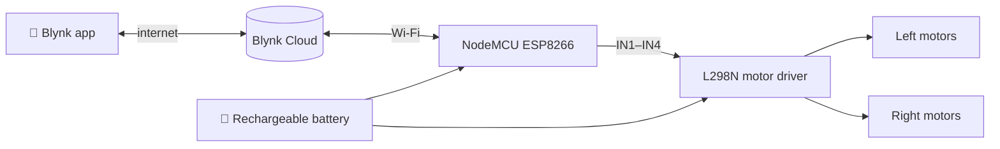

<div align="center">


### 🏎️ A four-wheel robot car you drive over the internet with your phone.


</div>

---

## 📌 At a glance

> The simplest way to see **IoT meet robotics**: a NodeMCU joins Wi-Fi, listens to buttons on a **Blynk** phone app, and drives four DC motors through an **L298N** motor driver. Because control goes through the cloud, the car can be driven **from any place with internet**.

The same NodeMCU + Blynk control idea runs my later robots, such as the [surveillance robot](https://github.com/technolkar/Multifunction-Semi-Autonomous-Vehicle-) and the [solar agriculture robot](https://github.com/technolkar/Multipurpose-Agriculture-Robot-).

---

## 🔄 How it works



---

## 🔌 Hardware

| Part | Role |
|---|---|
| **NodeMCU (ESP8266)** | Wi-Fi + control |
| **L298N dual H-bridge** | Direction control of the motor pairs |
| **4 × DC geared motors** | Drive |
| **Rechargeable battery** | Power for motors and electronics |

| NodeMCU pin | L298N input |
|:---:|:---:|
| D1 · D2 | IN1 · IN2 |
| D4 · D5 | IN3 · IN4 |

---

## 🎮 Controls

| Blynk pin | Action |
|:---:|---|
| `V1` | Motor pair 1 forward |
| `V2` | Motor pair 1 backward |
| `V3` | Motor pair 2 forward |
| `V4` | Motor pair 2 backward |

Pressing both forward buttons drives straight; one side only turns the car.

---

## 💻 Code

[`IOT_CAR_USING_NODEMCU.ino`](IOT_CAR_USING_NODEMCU.ino):

```cpp
BLYNK_WRITE(V1) {                        // motor pair 1 forward
  int button = param.asInt();
  digitalWrite(MOTORB_1, button ? HIGH : LOW);
  digitalWrite(MOTORB_2, LOW);
}
```

<details>
<summary><b>▶ How to run it</b></summary>

1. Install the **ESP8266 board package** and **Blynk** library
2. Enter **your own** Blynk auth token and Wi-Fi details
3. Wire the L298N as in the pin table and upload
4. Add four buttons (`V1`–`V4`) in the Blynk app and drive

</details>

---

<div align="center">

### 👋 Built by **Ajay Arjun Mannolkar**
[](https://technolkar.github.io)
[](https://www.linkedin.com/in/ajaymannolkar)
[](https://www.youtube.com/@TechnolkarInnovations)


</div>
